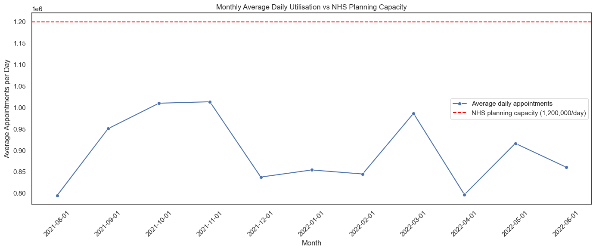
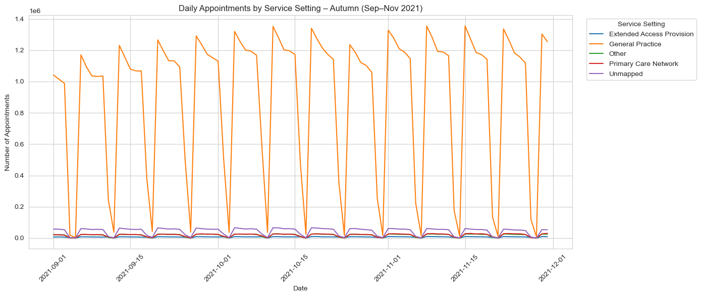
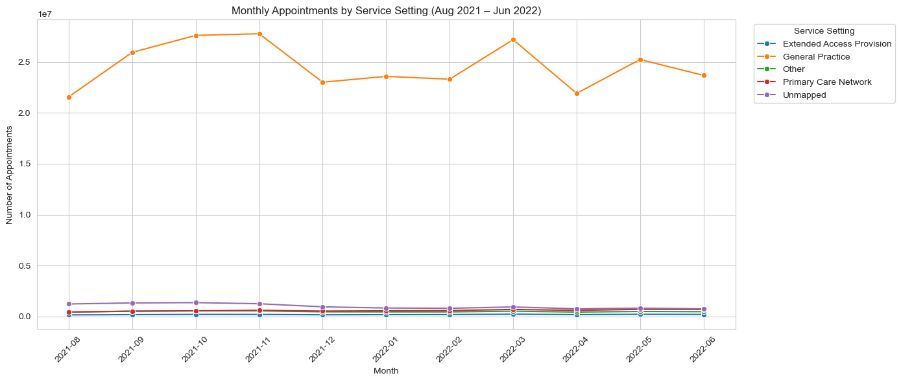
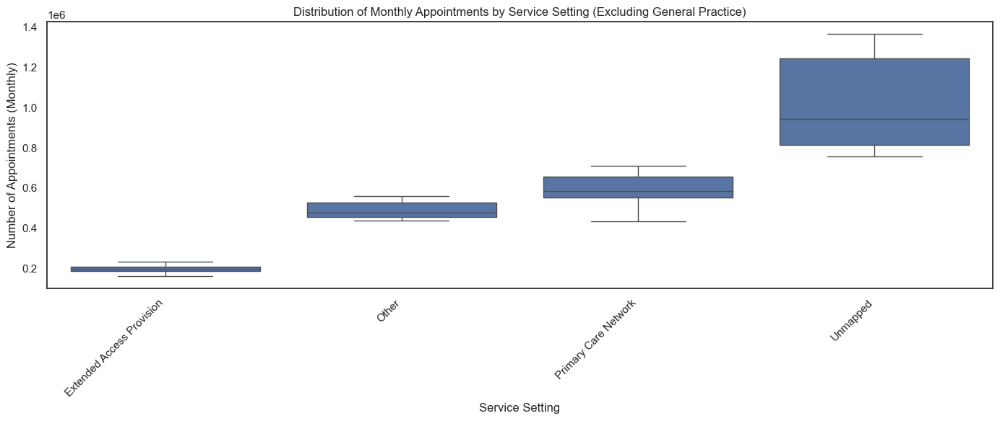
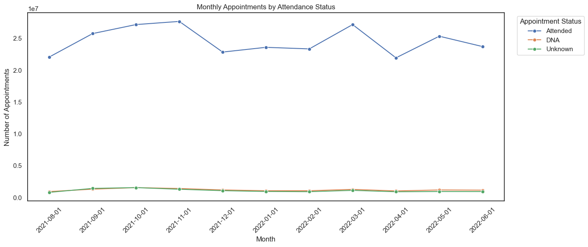

# NHS Appointments: Capacity and Utilisation Analysis

Exploratory data analysis in Python of NHS England's appointment data (2020–2022), carried out to inform a budgeting decision: should the NHS expand GP capacity, or make better use of the resources it already has?

---

## 🩺 Project Overview

The NHS needs to plan infrastructure and budgets for a growing population, but stakeholders have conflicting opinions on the way forward. Some believe capacity must increase; others believe current capacity is adequate but underused. Missed GP appointments add avoidable cost to both positions and are poorly understood.

My task was to explore the available appointment data, identify utilisation trends, and give the NHS evidence rather than opinion to base the decision on.

## ❓ Business Questions

1. Was there adequate staff and capacity in the networks?
2. What was the actual utilisation of resources?
3. Can external data from Twitter/X add value to the decision?

## Deliverables

| Deliverable | Audience | Description |
|---|---|---|
| [Jupyter Notebook](notebooks/nhs_appointment_analysis.ipynb) | Technical | Full analysis: code, outputs and written observations |
| [Technical Report](reports/technical_report.pdf) | Technical | Approach, decisions and validation detail for reproducing the results |
| [Presentation](reports/presentation.pdf) | Business stakeholders | Data-driven story of the findings and recommendations |

## 🛠️ Tools & Libraries Used

| Tool/Library | Purpose |
|---|---|
| Python | Core language for the analysis |
| pandas | Importing, cleaning, filtering, grouping and aggregating data |
| NumPy | Numerical operations |
| matplotlib & seaborn | Line charts, bar charts, boxplots and benchmark lines |
| Jupyter Notebook | Combining code, outputs and commentary in one document |

---

## Analytical Approach

### 1. Importing and Exploring
Each dataset was loaded into its own DataFrame and profiled with `.head()`, `.info()`, `.describe()` and `.isnull().sum()` to check shape, data types and completeness. I counted unique locations, service settings, context types, national categories and appointment statuses, and identified the five busiest locations.

### 2. Data Quality Audit
`.isnull()` reported **no missing values**, but auditing categorical columns with `.value_counts()` showed missing data recorded as category labels instead:

| Field | Placeholder value | Share of rows |
|---|---|---|
| `appointment_status` | Unknown | 33.7% |
| `hcp_type` | Unknown | 21.7% |
| `appointment_mode` | Unknown | 13.3% |
| `actual_duration` | Unknown / Data Quality | 14.6% |
| `service_setting`, `context_type` | Unmapped, Inconsistent Mapping | Present |

A standard null check would have reported clean data, so every figure built on these fields was treated with caution.

### 3. Data Preparation
- **Dates:** each dataset used a different date format, so each was converted with an explicit format string in `pd.to_datetime()` to avoid day/month mix-ups.
- **Time window:** the datasets start on different dates, so cross-dataset comparisons were limited to the shared period (Dec 2021 – Jun 2022).
- **No merge:** `appointments_regional` reports at regional (ICB) level while the others report at local (sub-ICB) level, so datasets were kept separate rather than merged.
- **Sum, not count:** each row is a pre-aggregated count, so volumes were calculated with `groupby()` and `.sum()` on `count_of_appointments`. Counting rows would measure reporting detail, not patient activity.

### 4. Analysis and Visualisation
Monthly line charts tracked trends by service setting, context type, national category, staff type, attendance status, appointment mode and booking lead time. Daily charts for each season and boxplots comparing service settings followed. Charts were refined as the analysis progressed: General Practice was excluded from a second chart because its scale hid every other setting, and the 18 national categories were filtered to the top 6 for readability.

### 6. Twitter/X Analysis
Hashtags were extracted from tweet text, counted, and plotted where used more than 10 times. Variants of the generic "#healthcare" tag (differing only in capitalisation or punctuation) were removed to surface genuine topics.

---

## 📊 Key Insights

### Capacity looks adequate on average...



Average daily appointments (monthly total ÷ 30) ranged from **0.80M in August 2021 to 1.01M in October–November 2021**, never crossing the NHS planning figure of 1.2M per day.

### ...but not on peak weekdays



Daily data shows appointments fall to near zero every weekend and peak on weekdays. On peak weekdays in October–November and March, **General Practice alone reached around 1.3M appointments**, above the 1.2M planning figure. Monthly averages hide this by spreading weekday activity across weekends.

### Demand peaks in October–November and March



November 2021 was the busiest month (**30.4M appointments**), followed by October 2021 and March 2022. The same pattern appears across every breakdown tested. December's dip lines up with the Christmas closure period, not lower demand.

### General Practice carries the workload, and "Unmapped" hides part of the rest



General Practice accounted for **86.5%** of appointments in North West London (Jan–Jun 2022) and dominates nationally. Outside General Practice, **"Unmapped" is the largest service setting**, so part of the NHS's remaining activity can't be traced to any specific service.

### Most appointments are attended, and most are booked the same day



Attended appointments far exceed missed (DNA) and Unknown every month. DNA rises and falls with overall demand rather than spiking on its own. "Same Day" is also the largest booking category every month, holding its share even during peak months.

### Twitter/X adds limited value

Hashtags show what people discuss (AI, digital health, telehealth), but the sample has no timestamps to link to appointment trends and reflects active social media users rather than the patient population.

---

## 💡 Recommendations

**Business recommendations**
1. Plan additional weekday capacity for October–November and March, the most consistent peaks in the data.
2. Measure capacity against peak-day totals, not monthly averages, before committing to any staffing decision.
3. Protect December availability rather than reducing it, since its dip reflects closures, not lower demand.
4. Use Twitter/X as a supplementary signal only, not as evidence for staffing decisions.

**Technical recommendations**
1. Fix data capture for appointment status, staff type and service setting. Reducing "Unknown" and "Unmapped" records is low cost and makes every other figure more reliable.
2. Report missed appointments by appointment volume, not row count, as counting rows overstates the problem.
3. Link booking lead time to attendance to test whether longer waits lead to more missed appointments.

## ⚠️ Limitations

- No staffing dataset was provided, so capacity is inferred from appointment volume.
- The datasets only fully overlap from December 2021 to June 2022.
- Less than one full year of `national_categories` data, so seasonality can't yet be confirmed as recurring.
- Large "Unknown" and "Unmapped" categories limit the precision of rate calculations.

## 📁 Repository Content

```
nhs-appointment-analysis/
├── notebooks/
│   └── nhs_appointment_analysis.ipynb
├── reports/
│   ├── technical_report.pdf
│   └── presentation.pdf
├── images/
└── README.md
```

## 👤 Author

**Bosola Odunuga** · [LinkedIn](https://www.linkedin.com/in/bosola-odunuga-41507012a/)
